# 🏥 Hospital Emergency Priority System (HEPS)

[](https://openjdk.org/projects/jdk/17/)
[](https://openjfx.io/)
[](https://www.mysql.com/)
[](https://maven.apache.org/)
[](https://junit.org/junit5/)
[](LICENSE)

> **An enterprise-grade Emergency Department (ED) clinical triage, heap-based priority queue management, and physician workstation system.**  
> Built with Java 17, JavaFX 21, MySQL 8, and layered Clean Architecture.

---

## 📌 1. Project Overview & Clinical Problem Statement

In standard hospital outpatient clinics, patients are registered and evaluated in **First-Come, First-Served (FIFO)** order. However, in an **Emergency Department (ED)**, medical urgency supersedes arrival sequence. A patient presenting with acute ST-elevation myocardial infarction (STEMI) or respiratory failure must receive immediate resuscitation ahead of patients presenting with minor lacerations, regardless of who arrived first.

The **Hospital Emergency Priority System (HEPS)** solves this by automating clinical triage and queue management:
- **Clinical Urgency Stratification:** Automated classification into 4 standardized urgency tiers: **CRITICAL (Level 1)**, **HIGH (Level 2)**, **MEDIUM (Level 3)**, and **LOW (Level 4)** based on the Manchester Triage System (MTS) and Emergency Severity Index (ESI).
- **In-Memory Min-Heap Priority Queue:** Queue orchestration powered by Java Collections `PriorityQueue<Patient>` using a 3-tier custom `PatientPriorityComparator` ($O(\log n)$ insertions and extractions).
- **Dynamic Starvation Prevention (Escalation Engine):** Automatically escalates patient urgency as wait times exceed clinical thresholds to prevent starvation of non-critical patients.
- **Physician Workstation & Journey Stepper:** Full doctor workspace with 5-step circular journey tracking, SOAP clinical documentation, STAT orders, and a real-time National Early Warning Score (NEWS2) deterioration watchdog.
- **Relational Persistence & Auditing:** Real-time persistence across MySQL 8 with JDBC transaction management, automated audit trail logging, and PDF discharge summaries.

---

## 🖥️ 2. Visual Walkthrough & Screen Gallery

### 🩺 Doctor Workspace & Clinical Management
*Interactive clinical dashboard featuring a 2-line patient banner, 5-step circular journey stepper, and 4 underline tabs: Vitals Trend Line Chart, Latest Vitals 2x2 Grid, and Diagnostic Orders.*
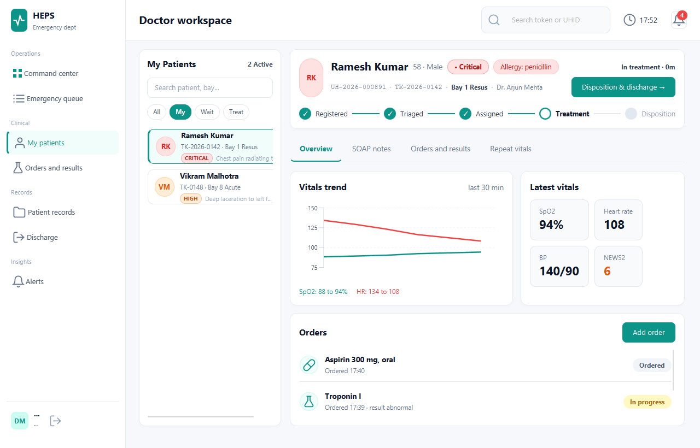

---

### 📊 Executive Command Center
*Real-time ED overview displaying patient throughput, waiting times, door-to-doctor metrics, and active emergency alert summaries.*
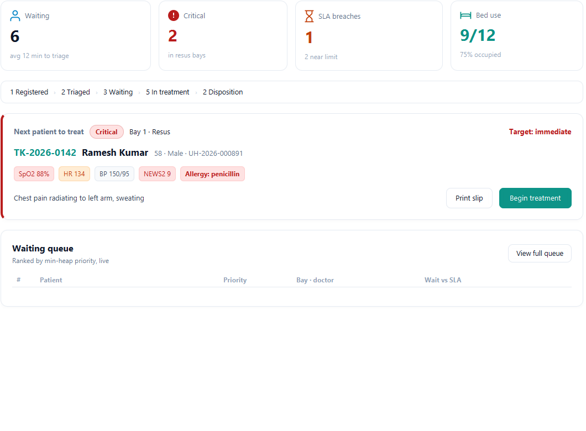

---

### 🚨 Emergency Priority Queue (Heap Order)
*Dynamic triage queue organized by clinical priority rank with live escalation timers, bay allocations, and filter tabs.*
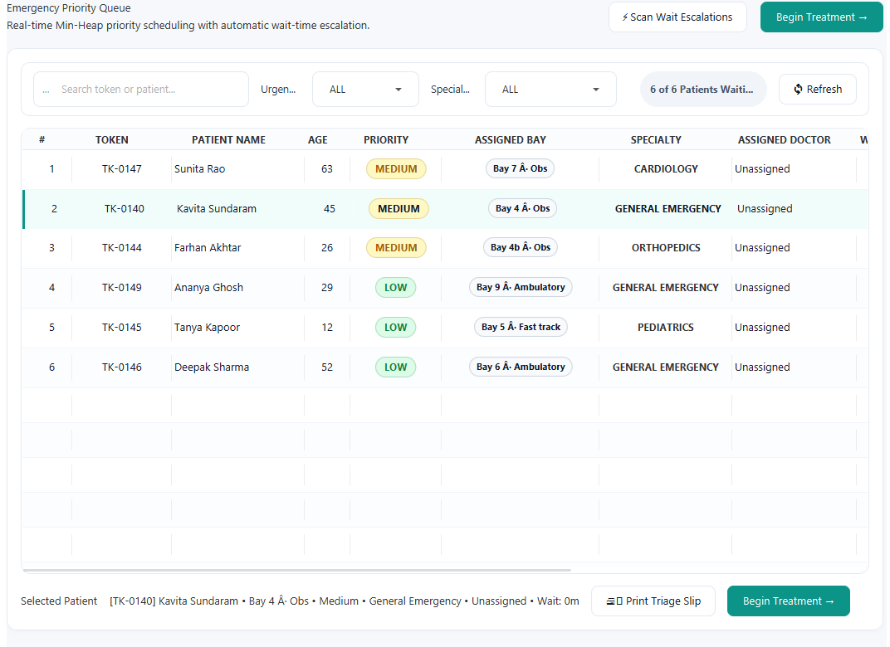

---

### 📝 Clinical SOAP Notes Documentation
*Structured clinical notes form with pre-filled chief complaints, triage vitals, live character counters, mandatory diagnosis/plan validation, and signed note history.*
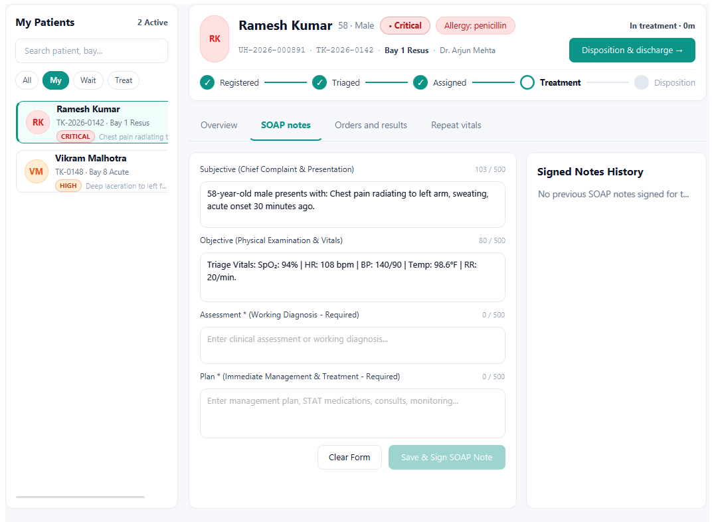

---

### 🧪 Diagnostic Orders & Laboratory Results
*Order placement toolbar with 6 quick STAT order chips, urgency selector, status tracking pills, and abnormal result indicators.*
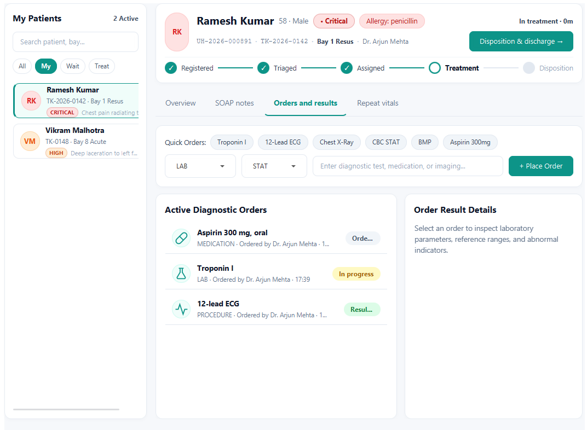

---

### 💓 Repeat Vitals & NEWS2 Deterioration Watchdog
*Null-safe serial vitals recording, real-time keystroke NEWS2 calculation, deterioration alert banner, and physiological history.*
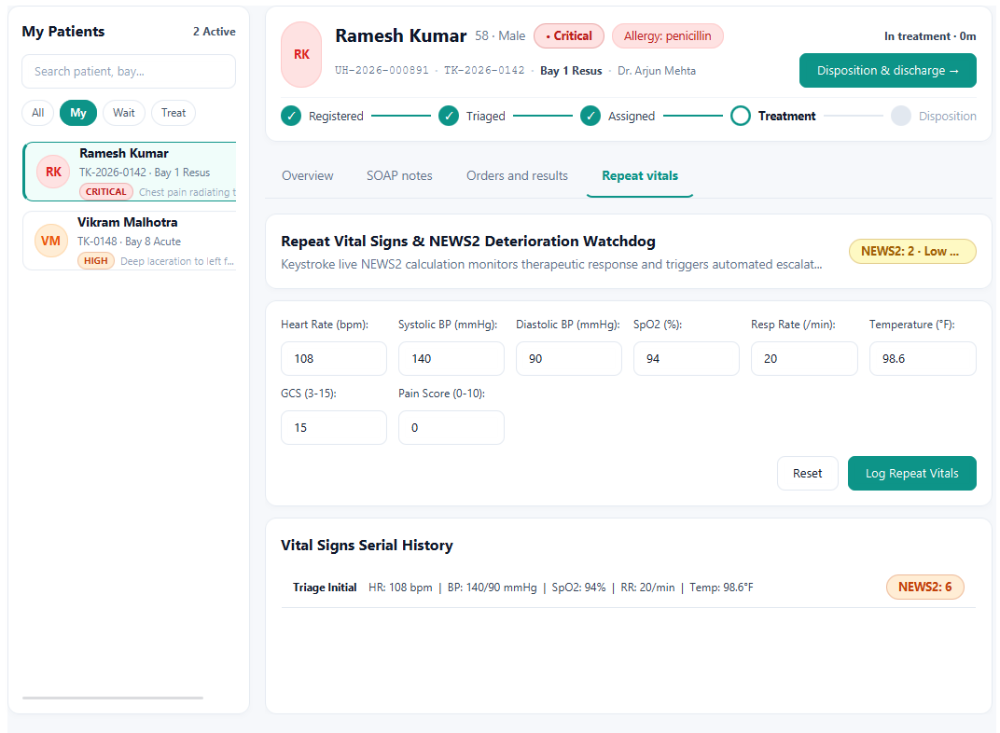

---

### 🏥 Bay Allocation & Occupancy Board
*Visual bed board across Resuscitation (Resus), Acute, and Sub-Acute zones with real-time occupancy and assigned clinical staff.*
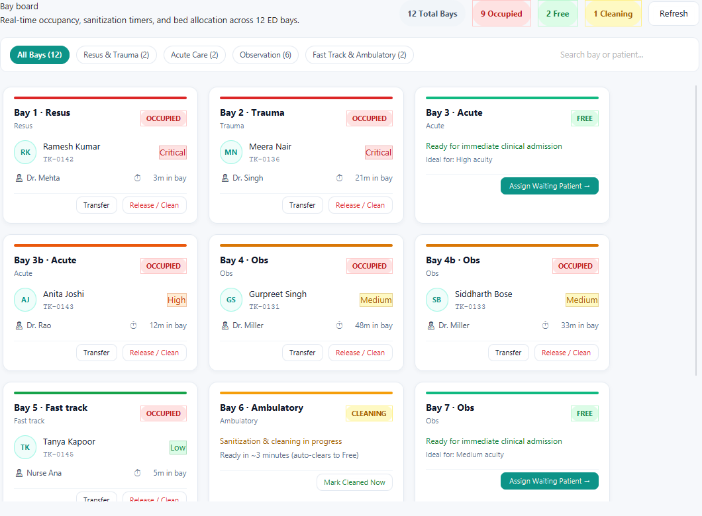

---

### 📈 Reports, Analytics & SLA Compliance
*Triage acuity pie chart, hourly patient arrival bar chart with full hour labels, and SLA benchmark compliance audit table.*
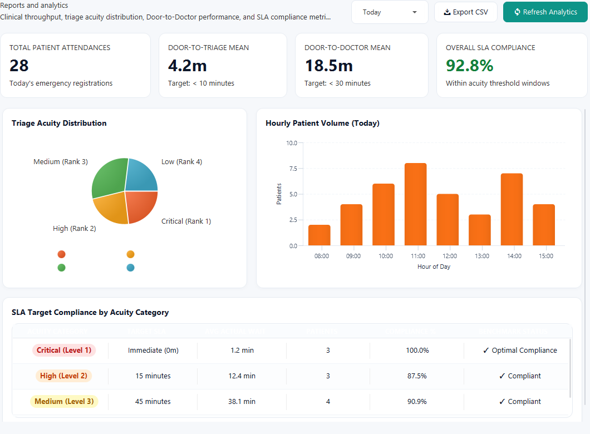

---

### 🚑 Mass Casualty Incident (MCI) Protocol
*START protocol disaster triage mode with international color categorization (Red, Yellow, Green, Black) and rapid casualty intake.*
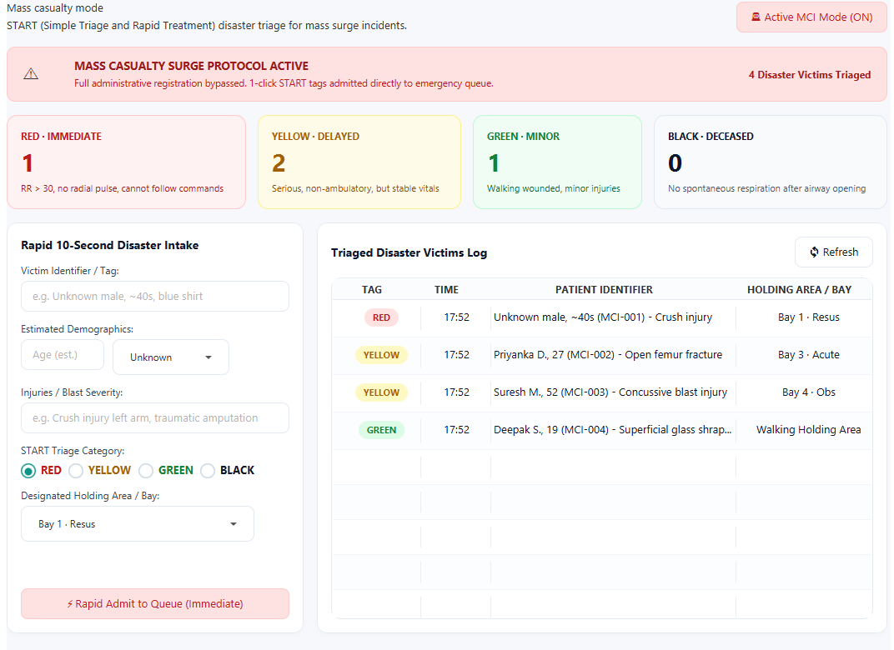

---

### 🎫 Thermal Triage Ticket & QR Code
*Digital triage ticket generation with ZXing 2D QR code for patient self-tracking and bedside scanning.*
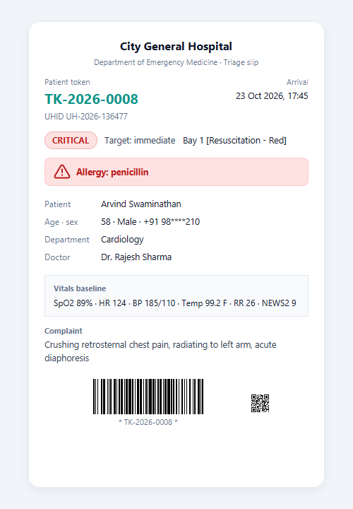

---

## 🛠️ 3. Technology Stack

| Layer / Concern | Technology | Version | Purpose |
| :--- | :--- | :--- | :--- |
| **Language** | Java (OpenJDK Temurin) | 17 LTS | Core backend logic, OOP encapsulation, Java Collections |
| **GUI Framework** | JavaFX | 21.0.2 | Hardware-accelerated desktop UI views and controllers |
| **View Layout** | FXML | JavaFX 21 | Declarative screen layout structure (0 inline styles) |
| **Styling** | Vanilla CSS | Custom Design System | Light clinical palette (`#0D9488` teal, `#F6F8FB` canvas, Inter font) |
| **Persistence** | MySQL Server | 8.4 LTS | Relational database storage with foreign key constraints |
| **Database Driver** | MySQL Connector/J | 8.4.0 | JDBC database connectivity and connection management |
| **Security & Auth** | jBCrypt | 0.4 | Salted BCrypt password hashing for staff authentication |
| **Barcode / QR** | Google ZXing | 3.5.3 | Generation of 2D QR codes on clinical triage tickets |
| **Document Generation** | Apache PDFBox | 3.0.2 | Automated generation of patient discharge summary PDFs |
| **Build & Packaging** | Apache Maven & Shade | 3.9.9 / 3.5.1 | Lifecycle management and shaded executable uber-JAR bundling |
| **Automated Testing**| JUnit 5 (Jupiter) | 5.10.2 | Unit and integration test coverage across all business logic |

---

## 🏗️ 4. Architecture & Design Patterns

HEPS follows **Layered Clean Architecture** and established **Object-Oriented Design Patterns**:

```mermaid
graph TD
    subgraph Presentation_Layer ["Presentation Layer (JavaFX / FXML / CSS)"]
        UI["Application Window (App.java / Launcher.java)"]
        MainCtrl["MainController (Sidebar, Clock, Alerts Badge)"]
        DocCtrl["DoctorWorkspaceController (Banner, Stepper, 4 Tabs)"]
        DashCtrl["DashboardController (KPI Metrics & Acuity Overview)"]
        QueueCtrl["EmergencyQueueController (Heap Table & Filter Chips)"]
        BayCtrl["BayBoardController (Zone & Bed Occupancy)"]
        OrderCtrl["OrdersResultsController (STAT Chips & Lab Result Panel)"]
        DispCtrl["DispositionController (Discharge & PDF Generation)"]
        ReportCtrl["ReportsController (Charts & SLA Compliance Audits)"]
    end

    subgraph Service_Layer ["Service Layer (Business Logic & State Machines)"]
        PatientSvc["PatientService (Validation & Patient Registration)"]
        QueueSvc["QueueService (Triage State & PriorityQueue Engine)"]
        DocRouteSvc["DoctorRoutingService (Automated Specialty Doctor Matching)"]
        NEWS2Svc["NEWS2Service (Physiological Scoring & Watchdog Alerts)"]
        TriageEngine["JavaTriageRuleEngine (Manchester / ESI Acuity Rules)"]
        OrderSvc["OrderService (Diagnostic Orders & Lab Results)"]
        BaySvc["BayService (Bed Allocation & Availability)"]
        AuditSvc["AuditService (Clinical Event Logging)"]
        UserSession["UserSession (Role-Based Access Control - RBAC)"]
    end

    subgraph Domain_DSA_Layer ["Domain & Data Structures Layer"]
        PQ["PriorityQueue&lt;Patient&gt; (In-Memory Min-Heap)"]
        Comp["PatientPriorityComparator (3-Tier Ordering Logic)"]
        SM["PatientStateMachine (Strict State Transitions)"]
        Models["Domain Models: Patient, Doctor, Bay, Order, Vitals, AuditLog"]
        Enums["Enums: EmergencyLevel, PatientStatus, Role, Specialty"]
    end

    subgraph Persistence_Layer ["Data Access Layer (DAO Pattern & JDBC)"]
        PatientDao["PatientDao / PatientDaoImpl"]
        DoctorDao["DoctorDao / DoctorDaoImpl"]
        BayDao["BayDao / BayDaoImpl"]
        OrderDao["OrderDao / OrderDaoImpl"]
        AuditDao["AuditDao / AuditDaoImpl"]
        UserDao["UserDao / UserDaoImpl"]
        DBConn["DBConnection (Connection Pooling & Validation)"]
        MySQL[("MySQL 8.4 Relational Database")]
    end

    UI --> MainCtrl
    MainCtrl --> DocCtrl
    MainCtrl --> DashCtrl
    MainCtrl --> QueueCtrl
    MainCtrl --> BayCtrl
    MainCtrl --> OrderCtrl
    MainCtrl --> DispCtrl
    MainCtrl --> ReportCtrl

    DocCtrl --> QueueSvc
    DocCtrl --> NEWS2Svc
    DocCtrl --> OrderSvc
    DocCtrl --> AuditSvc
    QueueCtrl --> QueueSvc
    QueueCtrl --> DocRouteSvc
    DispCtrl --> PatientSvc
    DispCtrl --> AuditSvc

    QueueSvc --> PQ
    PQ -.-> Comp
    QueueSvc --> SM
    QueueSvc --> PatientDao
    OrderSvc --> OrderDao
    BaySvc --> BayDao
    AuditSvc --> AuditDao

    PatientDao --> DBConn
    DoctorDao --> DBConn
    BayDao --> DBConn
    OrderDao --> DBConn
    AuditDao --> DBConn
    UserDao --> DBConn
    DBConn --> MySQL
```

### Key Design Patterns Implemented:
1. **Model-View-Controller (MVC):** Strict separation between FXML view definitions, CSS stylesheets, and JavaFX controllers.
2. **Data Access Object (DAO) Pattern:** Decoupled interfaces (`PatientDao`, `DoctorDao`, `OrderDao`, `TreatmentRecordDao`) isolate persistence logic from domain services.
3. **Singleton Pattern:** Controlled single instances for core services (`QueueService`, `UserSession`, `AlertService`, `AuditService`, `DBConnection`).
4. **State Machine Pattern:** `PatientStateMachine` enforces deterministic, valid clinical status transitions (`REGISTERED` $\rightarrow$ `TRIAGED` $\rightarrow$ `IN_TREATMENT` $\rightarrow$ `DISCHARGED` / `ADMITTED` / `TRANSFERRED` / `DECEASED`), throwing `InvalidStateTransitionException` on illegal jumps.
5. **Comparator & Min-Heap DSA:** Custom 3-tier comparator:
   $$\text{Rank}_1 (\text{EmergencyLevel}) \succ \text{Rank}_2 (\text{Arrival Timestamp}) \succ \text{Rank}_3 (\text{Token ID})$$
6. **Watchdog Alert Pattern:** Asynchronous physiological monitors continuously evaluate vital signs, calculating NEWS2 scores and dispatching escalation notifications when clinical deterioration is detected.

---

## 🗄️ 5. Database Schema & Architecture

The system utilizes an optimized MySQL 8 relational schema with foreign key constraints, indexes on lookup tokens, and timestamps:

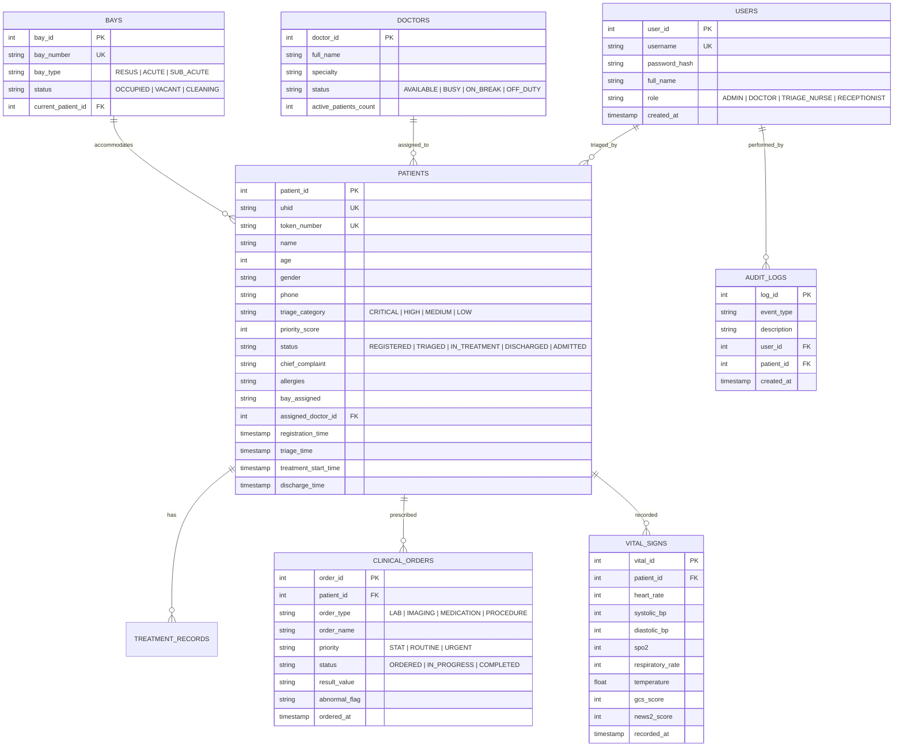

---

## 🚀 6. Getting Started & Installation

### Prerequisites
* **Java Development Kit (JDK):** Version 17 LTS (OpenJDK Temurin or Oracle JDK 17+).
* **Apache Maven:** Version 3.8.0 or higher.
* **MySQL Server:** Version 8.0 or higher running locally on port `3306`.
* **Git:** For cloning the repository.

---

### Step 1: Clone the Repository
```bash
git clone https://github.com/Jamal-Khan-I/HEPS.git
cd HEPS
```

---

### Step 2: Database Setup & Configuration
1. Start your local MySQL server.
2. Open your MySQL client (MySQL Workbench, phpMyAdmin, or CLI) and run the initialization scripts located in `database/`:
```bash
mysql -u root -p < database/schema.sql
mysql -u root -p < database/sample-data.sql
```
3. Verify your database credentials in `src/main/java/com/hospital/priority/util/DBConnection.java`:
```java
private static final String URL = "jdbc:mysql://localhost:3306/hospital_emergency_db?useSSL=false&allowPublicKeyRetrieval=true&serverTimezone=UTC";
private static final String USER = "root";
private static final String PASSWORD = "your_mysql_password"; // Set to your MySQL password (default is empty "")
```

---

### Step 3: Build & Compile
Compile the project and run the automated test suite:
```bash
mvn clean compile
mvn test
```
*All 37 unit and integration tests should pass.*

---

### Step 4: Run the Application
Launch the JavaFX desktop client directly via Maven:
```bash
mvn javafx:run
```

Or build an executable standalone uber-JAR:
```bash
mvn package -DskipTests
java -jar target/hospital-emergency-priority-system-1.0.0.jar
```

---

## 🔑 7. Default Authentication Credentials

The system provides 4 pre-configured role profiles for demonstration and testing:

| Role | Username | Password | Access Scope |
| :--- | :--- | :--- | :--- |
| **Emergency Physician** | `dr.mehta` | `doctor123` | Doctor Workspace, SOAP Notes, Orders, Repeat Vitals, Discharge |
| **Hospital Administrator** | `admin` | `admin123` | Full system access, Staff Management, Audit Trail, System Config |
| **Triage Nurse** | `nurse.priya`| `nurse123` | Patient Registration, Queue Sorting, Vitals Entry, Bay Assignment |
| **Receptionist** | `reception` | `recep123` | Initial Registration, Queue Board View, Ticket Printing |

---

## 🧪 8. Test Suite & Quality Assurance

HEPS includes **37 automated unit and integration tests** built on **JUnit 5**:

```bash
[INFO] -------------------------------------------------------
[INFO]  T E S T S
[INFO] -------------------------------------------------------
[INFO] Running com.hospital.priority.AIAgentOrchestratorTest           [2 tests - PASSED]
[INFO] Running com.hospital.priority.DatabaseQueueIntegrationTest       [1 test  - PASSED]
[INFO] Running com.hospital.priority.DoctorRoutingServiceTest          [3 tests - PASSED]
[INFO] Running com.hospital.priority.JavaTriageRuleEngineTest          [6 tests - PASSED]
[INFO] Running com.hospital.priority.JdbcPersistenceIntegrationTest     [1 test  - PASSED]
[INFO] Running com.hospital.priority.NEWS2ServiceTest                  [2 tests - PASSED]
[INFO] Running com.hospital.priority.PatientPriorityComparatorTest     [4 tests - PASSED]
[INFO] Running com.hospital.priority.PatientStateMachineTest           [3 tests - PASSED]
[INFO] Running com.hospital.priority.PriorityQueueEscalationTest       [2 tests - PASSED]
[INFO] Running com.hospital.priority.PriorityQueueOrderingTest         [3 tests - PASSED]
[INFO] Running com.hospital.priority.ScreenCaptureTest                 [1 test  - PASSED]
[INFO] Running com.hospital.priority.TokenGeneratorTest                [2 tests - PASSED]
[INFO] Running com.hospital.priority.ValidationUtilTest                 [7 tests - PASSED]
[INFO] 
[INFO] Results:
[INFO] Tests run: 37, Failures: 0, Errors: 0, Skipped: 0
[INFO] BUILD SUCCESS
```

---

## 🎨 9. Clinical Design System Tokens

HEPS strictly follows modern healthcare human-interface guidelines:
- **Base Canvas:** `#F6F8FB` (Soothing clinical off-white canvas)
- **Cards & Surfaces:** `#FFFFFF` (High-contrast card containers with 1px `#E5EAF1` border and 12px rounded radius)
- **Primary Accent:** `#0D9488` (Teal) with subtle `#F0FDFA` selection tint
- **Acuity Color Hierarchy:**
  - 🔴 **Critical:** `#B91C1C` on `#FEE2E2`
  - 🟠 **High:** `#C2410C` on `#FFEDD5`
  - 🟡 **Medium:** `#A16207` on `#FEF9C3`
  - 🟢 **Low:** `#15803D` on `#DCFCE7`
- **Typography:** `Inter`, `Segoe UI Variable Display`, sans-serif
- **Code Standards:** 0 inline styles in FXML, 0 emojis (all vector SVG paths), responsive fluid table layouts.

---

## 📄 10. License & Author

* **Author:** Jamal Khan ([@Jamal-Khan-I](https://github.com/Jamal-Khan-I))
* **Academic Course:** Object-Oriented Programming using Java (CSE203)
* **License:** This project is licensed under the [MIT License](LICENSE).
