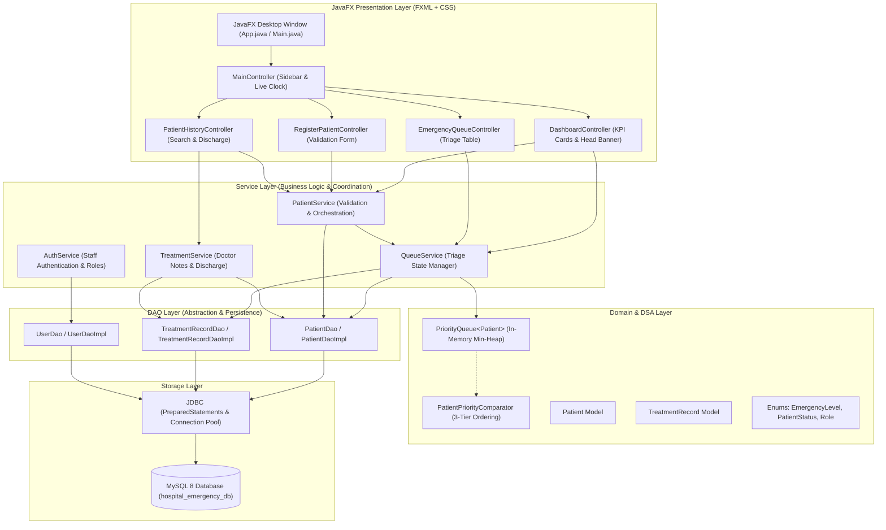

# Hospital Emergency Priority System (HEPS)

> **OOP using Java (CSE203) — Academic Mini Project**  
> An enterprise-grade Emergency Triage & Queue Management JavaFX desktop application powered by Java Collections `PriorityQueue` and MySQL persistence.

---

## 📌 1. Project Overview & Problem Statement

In standard hospital outpatient departments, patients are typically served in **First-Come, First-Served (FIFO)** order. However, in an **Emergency Department (ED)**, medical urgency takes precedence over arrival sequence. A patient experiencing acute myocardial infarction (heart attack) or stroke must be admitted ahead of patients with minor lacerations or mild fevers, regardless of who arrived first.

The **Hospital Emergency Priority System (HEPS)** solves this by automating clinical triage:
- Patients are categorized into 4 clinical urgency levels: **CRITICAL**, **HIGH**, **MEDIUM**, and **LOW**.
- The in-memory triage engine is powered by a **Java `PriorityQueue<Patient>`** using a dedicated **`PatientPriorityComparator`**.
- Ties on identical urgency levels are resolved fairly using arrival timestamps (FIFO within the same urgency tier), followed by unique token ordering.
- All patient registrations, queue transitions, and doctor consultation notes are persistently synchronized with a **MySQL 8** relational database through **JDBC PreparedStatements**.

---

## 🛠️ 2. Technology Stack

| Layer / Concern | Technology | Version | Purpose |
| :--- | :--- | :--- | :--- |
| **Language** | Java (OpenJDK Temurin) | 17 LTS | Core backend, OOP logic, Collections |
| **GUI Framework** | JavaFX | 21.0.2 | Desktop UI views and interactive controllers |
| **View Definition** | FXML | JavaFX 21 | Declarative screen layout structure |
| **Styling** | Vanilla CSS | Custom Design System | Modern hospital palette, color badges, responsive tables |
| **Build & Dependency**| Apache Maven | 3.9.9 | Project lifecycle, plugin orchestration, build artifact |
| **Persistence** | MySQL Server | 8.4 LTS | Relational database persistence on localhost |
| **Database Driver** | MySQL Connector/J | 8.4.0 | JDBC database connectivity |
| **Testing** | JUnit 5 (Jupiter) | 5.10.2 | Automated unit and integration testing |
| **Architecture** | Layered Architecture | Clean DAO / Service | Separation of concerns (UI ⇄ Service ⇄ Model ⇄ DAO ⇄ JDBC) |

---

## 🏗️ 3. Architecture Diagram



---

## 📂 4. Project Folder Structure

```
hospital-emergency-priority-system/
├── pom.xml                                  # Maven dependencies, plugins, and Java 17/21 compiler config
├── README.md                                # Complete technical documentation and setup guide
├── .gitignore                               # Excludes build artifacts and local config.properties
├── database/
│   ├── schema.sql                           # MySQL DDL (patients, treatment_records, users)
│   └── sample-data.sql                      # Seed data (12 patients across all urgency levels & statuses)
├── docs/
│   └── PROJECT_REPORT.md                    # Academic project report for CSE203 evaluation
├── src/
│   ├── main/
│   │   ├── java/com/hospital/priority/
│   │   │   ├── App.java                     # JavaFX application launcher & database bootstrapper
│   │   │   ├── Main.java                    # Standalone main wrapper avoiding modular classpath issues
│   │   │   ├── controller/                  # JavaFX Controllers
│   │   │   │   ├── MainController.java
│   │   │   │   ├── DashboardController.java
│   │   │   │   ├── RegisterPatientController.java
│   │   │   │   ├── EmergencyQueueController.java
│   │   │   │   ├── PatientHistoryController.java
│   │   │   │   └── AboutVivaController.java
│   │   │   ├── dao/                         # DAO Interfaces (OOP Abstraction)
│   │   │   │   ├── PatientDao.java
│   │   │   │   ├── TreatmentRecordDao.java
│   │   │   │   ├── UserDao.java
│   │   │   │   └── impl/                    # JDBC Implementations (PreparedStatements)
│   │   │   │       ├── PatientDaoImpl.java
│   │   │   │       ├── TreatmentRecordDaoImpl.java
│   │   │   │       └── UserDaoImpl.java
│   │   │   ├── exception/                   # Custom Exception Hierarchy
│   │   │   │   ├── InvalidPatientDataException.java
│   │   │   │   ├── PatientNotFoundException.java
│   │   │   │   └── DatabaseOperationException.java
│   │   │   ├── model/                       # Domain Entities & Dedicated Comparator
│   │   │   │   ├── Patient.java
│   │   │   │   ├── TreatmentRecord.java
│   │   │   │   ├── User.java
│   │   │   │   ├── EmergencyLevel.java      # CRITICAL, HIGH, MEDIUM, LOW
│   │   │   │   ├── PatientStatus.java       # WAITING, IN_TREATMENT, COMPLETED, CANCELLED
│   │   │   │   ├── Role.java                # ADMIN, RECEPTIONIST, DOCTOR
│   │   │   │   └── PatientPriorityComparator.java # Core DSA Comparator
│   │   │   ├── service/                     # Business Logic & In-Memory Queue Synchronization
│   │   │   │   ├── PatientService.java
│   │   │   │   ├── QueueService.java        # Authoritative PriorityQueue Manager
│   │   │   │   ├── TreatmentService.java
│   │   │   │   └── AuthService.java
│   │   │   └── util/                        # Helpers
│   │   │       ├── DBConnection.java        # Safe JDBC connection manager
│   │   │       ├── TokenGenerator.java      # Thread-safe atomic token dispenser
│   │   │       ├── ValidationUtil.java      # Input validation logic
│   │   │       └── PasswordHasher.java      # SHA-256 password security
│   │   └── resources/
│   │       ├── config.properties.example    # Safe template for local credentials
│   │       ├── config.properties            # Active local DB configuration (git-ignored)
│   │       ├── css/
│   │       │   └── style.css                # Modern hospital stylesheet & badge colors
│   │       └── fxml/                        # FXML UI Views
│   │           ├── main_layout.fxml
│   │           ├── dashboard.fxml
│   │           ├── register_patient.fxml
│   │           ├── emergency_queue.fxml
│   │           ├── patient_history.fxml
│   │           └── about_viva.fxml
│   └── test/java/com/hospital/priority/
│       ├── PatientPriorityComparatorTest.java # Verifies 3-tier triage ordering
│       ├── PriorityQueueOrderingTest.java     # Verifies heap extraction and removal
│       ├── TokenGeneratorTest.java            # Verifies token format and uniqueness
│       ├── ValidationUtilTest.java            # Verifies input rejection on invalid data
│       └── DatabaseQueueIntegrationTest.java  # Verifies DB loading into PriorityQueue
```

---

## ⚡ 5. Core Data Structures & Algorithms (DSA) Explanation

### The Java `PriorityQueue<Patient>`
At the core of the triage system is a Java Collections **`PriorityQueue<Patient>`**, instantiated with a dedicated **`PatientPriorityComparator`**:
```java
PriorityQueue<Patient> triageQueue = new PriorityQueue<>(new PatientPriorityComparator());
```
In Java, `PriorityQueue` is backed by a **balanced binary min-heap** stored inside an array:
- **`offer(patient)` (Enqueue)**: Sifts up the new patient to restore heap invariants in **$O(\log N)$** time.
- **`peek()` (Inspect Head)**: Examines the root element in **$O(1)$** constant time without removal.
- **`poll()` (Serve Next)**: Extracts the root (highest priority patient), moves the last leaf to root, and sifts down in **$O(\log N)$** time.

### The 3-Tier `PatientPriorityComparator` Logic
```java
public int compare(Patient p1, Patient p2) {
    // 1. Primary: Compare Emergency Level Rank (1=CRITICAL, 2=HIGH, 3=MEDIUM, 4=LOW)
    int urgency = Integer.compare(p1.getEmergencyLevel().getRank(), p2.getEmergencyLevel().getRank());
    if (urgency != 0) return urgency;

    // 2. Secondary (Tie-Breaker 1): FIFO by Arrival Time
    int arrival = p1.getArrivalTime().compareTo(p2.getArrivalTime());
    if (arrival != 0) return arrival;

    // 3. Tertiary (Tie-Breaker 2): Deterministic Token String
    return p1.getTokenNo().compareTo(p2.getTokenNo());
}
```

### ⚠️ Critical Viva Distinction: Snapshot Sorting
> **Examiner Question**: *"Why can't you simply bind the `PriorityQueue` directly to the JavaFX `TableView`?"*  
> **Answer**: The Java Collections specification explicitly states that an iterator or for-each loop over a `PriorityQueue` **does not guarantee visiting elements in sorted order**; it only guarantees that the head element at index 0 is the minimum. To display the emergency queue in strict #1 to #N order in the UI table without mutating the heap, `QueueService.getSortedSnapshot()` creates a copy list and sorts it using `PatientPriorityComparator` before passing it to the JavaFX ObservableList.

---

## 🗄️ 6. Database Setup Instructions (MySQL 8)

MySQL Server runs locally on **`127.0.0.1:3306`** (localhost only).

### Step 1: Create Database & Tables
Open your command terminal or MySQL Workbench and run:
```bash
mysql -u root -p < database/schema.sql
```

### Step 2: Seed Sample Data
Load 12 initial patient records with mixed urgency levels:
```bash
mysql -u root -p < database/sample-data.sql
```

### Step 3: Configure Connection
Ensure `src/main/resources/config.properties` has your local credentials:
```properties
db.url=jdbc:mysql://127.0.0.1:3306/hospital_emergency_db?useSSL=false&allowPublicKeyRetrieval=true&serverTimezone=UTC
db.user=root
db.password=YOUR_PASSWORD_HERE
```
*(Leave `db.password=` blank if root has no password on localhost).*

---

## 🚀 7. How to Build and Run the Application

### Prerequisites
- **JDK 17 LTS** (Temurin or Oracle)
- **Apache Maven 3.9+**
- **MySQL 8+** running on localhost

### Step 1: Run Automated Tests
```bash
mvn clean test
```
*Expected output: `Tests run: 17, Failures: 0, Errors: 0, Skipped: 0`.*

### Step 2: Launch the JavaFX Desktop App
```bash
mvn javafx:run
```
Alternatively, package and run the JAR:
```bash
mvn package
java -jar target/hospital-emergency-priority-system-1.0.0.jar
```

---

## 🖼️ 8. User Interface Tour

1. **📊 Dashboard**:
   - 4 Emergency Metric Cards: *Total Waiting*, *Critical Waiting*, *In Treatment*, *Completed Today*.
   - Highest Priority Patient Callout Banner with one-click **"Serve Next Patient"**.
   - Queue preview table populated in strict priority order via `PatientPriorityComparator`.

2. **➕ Register Patient**:
   - Compact, responsive, aligned registration layout.
   - Immediate token indicator: *"Token generated after successful registration."*
   - Demo priority reference card (*"Demo priority reference - emergency level is selected by authorized staff"*).
   - Client-side validation for name, age, phone format, and clinical symptoms with informative error alerts.
   - Enqueues into in-memory `PriorityQueue` and persists to MySQL.

3. **⚡ Emergency Queue**:
   - Emergency Triage & Queue Management view displaying all waiting patients in strict priority order.
   - Color-coded badges:
     - 🔴 **CRITICAL**: Red
     - 🟠 **HIGH**: Orange
     - 🟡 **MEDIUM**: Amber/Yellow
     - 🟢 **LOW**: Green
   - Search by patient name/token and urgency level filter.
   - **"Serve Next Patient"**: Serves only current PriorityQueue head, prompts confirmation, sets `IN_TREATMENT`, logs to DB, and refreshes all screens.
   - **"Admit Selected to Treatment"**: Disabled until a WAITING patient is explicitly selected, clearly labeled for manual clinician override.

4. **📜 Patient Records & History**:
   - Complete record repository for all historical patients.
   - Multi-field filter (search keyword, emergency level, status).
   - Phone numbers safely masked in public/table view (`+91 98****001`).
   - Detailed clinical inspection drawer displaying unmasked phone, symptoms, attending doctor, and treatment notes.
   - **"Complete Treatment / Add Notes"** action for `IN_TREATMENT` patients with doctor name and discharge note capture.

*(Note: Academic viva questions, OOP evaluations, and examiner technical guides are maintained in [docs/PROJECT_REPORT.md](file:///e:/Antigravity%20IDE/hospital-emergency-priority-system/docs/PROJECT_REPORT.md) and Section 5 of this document, keeping the hospital staff desktop interface clean and realistic).*

---

## 👥 9. Team Role Allocation (CSE203 Rubric)

Aligned with **Milestone 1** of the course mini project guidelines:

| Role Title | Responsibilities | Key Contributions |
| :--- | :--- | :--- |
| **Team Coordinator** | Timeline, Git workflow, Viva prep | Repository structure, issue tracking, project presentation |
| **JavaFX Lead** | Desktop frontend & UI/UX | FXML layout designs, CSS theme, TableView custom cell badges |
| **Core Java & OOP Lead**| Business logic & models | Domain encapsulation, service layer, custom exception hierarchy |
| **DSA & Database Lead** | Algorithms & persistence | `PriorityQueue`, `PatientPriorityComparator`, MySQL schema, JDBC DAOs |

---

## 🌿 10. Git Workflow & Best Practices

- **Main Branch (`main`)**: Production-ready, stable releases.
- **Development Branch (`dev`)**: Active feature integration.
- **Feature Branches**:
  - `feature/priority-queue-dsa`
  - `feature/javafx-screens`
  - `feature/jdbc-dao-layer`
- Commit conventions: Standard conventional commits (`feat:`, `fix:`, `test:`, `docs:`).

---

## 🔮 11. Known Limitations & Future Enhancements

### Current Scope:
- In-memory `PriorityQueue` synchronizes with a single local MySQL instance suitable for hospital clinic workstations.
- Single active doctor/receptionist session.

### Future Enhancements:
- **WebSocket / Multi-Client Triage**: Real-time push notifications across multiple doctor consultation rooms.
- **SMS / WhatsApp Alerts**: Automated SMS notifications to attendants regarding estimated wait times.
- **Vital Signs Monitor Integration**: Automatic emergency escalation if IoT patient monitors detect oxygen desaturation or arrhythmia.
