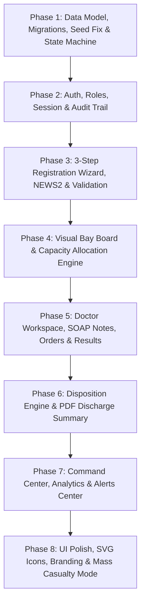

# HEPS Enterprise Upgrade Plan: Hospital Emergency Priority System
**Target System:** City General Hospital – Emergency Department (ED) Management System  
**Document Version:** 2.0.0-PROPOSAL  
**Author:** Senior Healthcare-Software Engineer & JavaFX UI/UX Architect  
**Status:** Under User Review  

---

## 1. Executive Summary & Problem Analysis

The existing **HEPS** (Hospital Emergency Priority System) demonstrates excellent core computer science fundamentals:
- Min-Heap priority scheduling via `java.util.PriorityQueue` and `PatientPriorityComparator`.
- Anti-starvation wait-time escalation.
- Deterministic vital signs rule engine (`JavaTriageRuleEngine`) and multi-agent AI consensus architecture (`AIAgentOrchestrator`).
- 32 passing unit and integration tests.

However, from an emergency medicine and clinical operations perspective, seven major gaps prevent it from functioning as a true hospital emergency department system:

| # | Current Defect / Gap | Clinical / Operational Impact | Target Solution in Upgrade |
|---|----------------------|-------------------------------|----------------------------|
| **1** | **No end-to-end patient workflow** | The app functions only as a queue viewer. Patients jump from "Waiting" to "Completed" without clinical milestones. | Strict 8-stage finite state machine (`PatientStateMachine`) tracking `REGISTERED → TRIAGED → WAITING → ASSIGNED → IN_TREATMENT → OBSERVATION / LAB_PENDING → DISPOSITION → COMPLETED`. |
| **2** | **Static Bays and Unassigned Doctors** | Every patient displays hardcoded "Bay 4" and "Unassigned" doctor without real capacity or duty roster tracking. | Dynamic Bay Management (12 bays: Resus 1-2, Acute 3, Observation 4, Fast Track 5, Ambulatory 6 + 6 Observation beds) with capacity locks, cleaning cycles, and active doctor shift assignments. |
| **3** | **Absurd Wait Times (53,168m / 886h ago)** | Seed data uses fixed timestamps from September 2026, leading to astronomical wait times on dashboard. | Dynamic relative timestamp generation (`NOW() - INTERVAL n MINUTE`) ensuring realistic real-time clinical wait times (2m to 110m). |
| **4** | **Optional / Missing Vitals** | Patients can be triaged with "Vitals not recorded", violating patient safety protocols. | Mandatory vitals enforcement (SpO2, HR, BP, RR, Temp, GCS, Pain Score 0-10) with automated NEWS2 scoring and explicit exception waivers. |
| **5** | **Missing Core Hospital Identifiers** | No UHID/MRN, arrival mode, allergies alert, GCS, doctor SOAP notes, diagnostic orders, or discharge summaries. | Comprehensive clinical data model: unique UHID (`UH-2026-XXXXXX`), return patient lookup, red allergy badges, SOAP notes, lab/imaging orders, and PDF discharge summaries. |
| **6** | **Single Hardcoded "Administrator" Login** | No role separation; clinical actions and system configuration are conflated. | Hospital-branded authentication system with 5 distinct roles (`RECEPTIONIST`, `TRIAGE_NURSE`, `DOCTOR`, `CHARGE_NURSE`, `ADMIN`), BCrypt hashing, role-filtered navigation, and audit trail. |
| **7** | **Generic Dashboard & Visual Defects** | Emojis render as broken glyphs (`□`), table columns are clipped, and layout lacks clinical hierarchy. | Apple Health / Epic-inspired clinical design system with crisp vector SVG icons, sticky patient header banners, visual bay boards, and Mass Casualty Mode. |

---

## 2. Target Architecture & Design Principles

```
+---------------------------------------------------------------------------------------+
|                                    PRESENTATION LAYER                                 |
|  JavaFX 21 (FXML + CSS + Pure SVG Icons + Responsive Splitpanes & Modal Drawers)     |
|                                                                                       |
|  [Top Bar: Brand, Shift, Clock, Global Search, Real-Time Alerts Badge, Profile Pill]   |
|  +----------------------+----------------------------------------------------------+  |
|  | ROLE-FILTERED NAV    | ACTIVE SCREEN CONTROLLER                                 |  |
|  | - Operations         |  * ED Command Center (KPIs, Pipeline, Bay Board, Alerts) |  |
|  | - Clinical           |  * 3-Step Registration & Triage Wizard                   |  |
|  | - Records            |  * Priority Emergency Queue with Live SLA Timers         |  |
|  | - Insights           |  * Visual 12-Bay Board with Drag/Click Allocation        |  |
|  | - Admin Settings     |  * Doctor Clinical Workspace (SOAP, Orders, Results)     |  |
|  | [Mass Casualty Toggle|  * Patient Records & Visit History                     |  |
|  +----------------------+----------------------------------------------------------+  |
+---------------------------------------------------------------------------------------+
                                           |
                                           v
+---------------------------------------------------------------------------------------+
|                                     SERVICE LAYER                                     |
|  * AuthService (BCrypt, Session Context, Role Guard)                                  |
|  * PatientStateMachine (Enforced clinical transitions & transition guards)             |
|  * QueueService (Min-Heap PriorityQueue, Anti-Starvation Escalation, Clock Injected)   |
|  * NEWS2CalculationEngine (National Early Warning Score 2)                            |
|  * JavaTriageRuleEngine & AIAgentOrchestrator (Dual-layer safety consensus)           |
|  * BayService (Capacity management, Cleaning timer, Auto-allocation)                  |
|  * DoctorRosterService (Duty shifts, Specialty routing, Active workload)              |
|  * OrderService (Lab, Imaging, Medication lifecycle management)                       |
|  * DispositionService (ICD-10 clinical outcomes, Discharge summary PDF engine)         |
|  * AuditService (Immutable audit log for medical-legal compliance)                    |
|  * ReportAnalyticsService (ED throughput, SLA compliance, Acuity mix)                 |
+---------------------------------------------------------------------------------------+
                                           |
                                           v
+---------------------------------------------------------------------------------------+
|                               DATA ACCESS LAYER (DAO)                                 |
|  * PatientDao, VisitDao, VitalsDao, BayDao, DoctorDao, OrderDao, ClinicalNotesDao      |
|  * UserDao, AuditLogDao, SettingsDao                                                  |
|  * Self-Healing Schema Migrator (Auto-detects missing tables/columns, zero data loss)  |
|  * DBConnection Pool & Failover (Graceful offline banner with auto-reconnect)         |
+---------------------------------------------------------------------------------------+
                                           |
                                           v
+---------------------------------------------------------------------------------------+
|                                   PERSISTENCE LAYER                                   |
|                             MySQL 8.4 Enterprise Database                             |
+---------------------------------------------------------------------------------------+
```

---

## 3. Phase-by-Phase Implementation Roadmap

The upgrade is partitioned into **8 sequential phases**. Each phase is independently testable, guarantees zero data loss, preserves backwards compatibility, and ends with a compiling Maven build and passing test suite.



---

### Phase 1: Data Model, Migrations, Realistic Seed Data & Patient State Machine
**Goal:** Establish the enterprise clinical domain model, decouple patient identity from emergency visits, fix wait time seed data, and enforce lifecycle transitions.

#### Detailed Deliverables:
1. **Clinical State Machine (`PatientStateMachine` & `PatientStatus`):**
   - Allowed lifecycle states: `REGISTERED` → `TRIAGED` → `WAITING` → `ASSIGNED` → `IN_TREATMENT` → `OBSERVATION` / `LAB_IMAGING_PENDING` → `DISPOSITION` → `COMPLETED` (or terminal: `LWBS`, `DECEASED`).
   - Strict transition rules with `InvalidStateTransitionException` and audit logging.
2. **Database Schema Enhancements (Self-Healing, Versioned Migrations):**
   - `patients_master`: UHID (primary key), full name, DOB, gender, phone, address, emergency contact, blood group, allergies list.
   - `visits`: Tracks current emergency encounter (`visit_id`, `uhid`, `token_no`, `arrival_mode`, `mlc_flag`, `status`, `emergency_level`, `gcs`, `pain_score`, `news2_score`, `bay_id`, `doctor_id`, timestamps, escalation flags).
   - `vitals_log`: Structured table for initial and serial vital signs (`spo2`, `heart_rate`, `temperature`, `systolic_bp`, `diastolic_bp`, `respiratory_rate`, `blood_glucose`, `recorded_by`, `recorded_at`).
   - `bays`: 12 emergency bays (`bay_id`, `name`, `type`, `status` [FREE/OCCUPIED/CLEANING/BLOCKED], `current_visit_id`, `updated_at`).
   - `orders`: Diagnostic tests, radiology, medication orders.
   - `clinical_notes`: Timestamped SOAP notes linked to visit.
   - `dispositions`: Clinical outcome, diagnosis ICD-10, discharge instructions.
   - `audit_log`: Detailed immutable audit records.
3. **Seed Data Fix (`database/seed.sql`):**
   - Eliminate hardcoded dates; generate records using `NOW() - INTERVAL n MINUTE`.
   - Seed realistic emergency cohort: 3 Critical (2–8 mins ago), 4 High (10–25 mins ago), 6 Medium (15–40 mins ago), 4 Low (30–60 mins ago), 3 In Treatment, 4 Completed.
4. **Clock Abstraction:**
   - Implement `HospitalClock` abstraction (injectable `java.time.Clock`) into `QueueService` to ensure deterministic testing of wait times, SLAs, and escalation.

**Verification:** Unit tests for all allowed and forbidden state transitions; database migration test; test suite runs clean.

---

### Phase 2: Authentication, Role-Based Access & Audit Trail
**Goal:** Replace the single hardcoded login with a multi-role hospital authentication system and comprehensive compliance auditing.

#### Detailed Deliverables:
1. **Hospital Login Screen (`LoginController` & `login.fxml`):**
   - Hospital branding: "City General Hospital – Emergency Department".
   - Username, password field with visibility toggle, error feedback.
   - "Demo Accounts" quick-fill chips for instant evaluator sign-in:
     - `receptionist` / `recep123` (Registration only)
     - `nurse_triage` / `triage123` (Triage nurse: vitals, assessment, bay prep)
     - `dr_sharma` / `doc123` (Cardiology / Emergency Physician)
     - `charge_nurse` / `charge123` (Bed manager, triage supervisor)
     - `admin` / `admin123` (System administrator)
2. **Security & Session Management:**
   - Password hashing via `BCrypt` (`at.favre.lib:bcrypt` or `jbcrypt`).
   - `UserSession` singleton holding active user, role, login timestamp, and permissions.
   - Auto-logout watchdog on 15 minutes of user inactivity.
3. **Role-Filtered Navigation:**
   - Sidebar dynamically renders permitted navigation items based on `UserSession.getRole()`.
   - User identity pill in top bar with role badge and "Sign Out" action.
4. **Audit Service & Admin Viewer (`AuditService`, `AuditLogController`):**
   - Synchronous/asynchronous logging of sensitive actions: User login/logout, patient registration, triage override, bay allocation, treatment start, clinical orders, and final disposition.
   - Admin audit log viewer with filter by user, role, patient token, date range, and action type.

**Verification:** Security unit tests verifying valid/invalid password authentication, session permission enforcement, and audit log generation.

---

### Phase 3: 3-Step Registration Wizard, NEWS2 Score & Validation
**Goal:** Upgrade patient intake from a monolithic form into an intuitive clinical workflow wizard with early warning scoring.

#### Detailed Deliverables:
1. **3-Step Wizard Architecture (`RegisterPatientController` & FXML):**
   - **Step 1: Identity & Arrival**
     - Auto-generated UHID (`UH-2026-XXXXXX`) and Token (`TK-YYYY-XXXX`).
     - Demographics (Name, Age/DOB, Gender, Contact, Emergency Contact, Address, Blood Group).
     - Returning patient auto-detection by phone number or Name+DOB: instantly surfaces past visits and known allergies.
     - Arrival Mode dropdown: Walk-in, Ambulance (EMS), Hospital Transfer, Police Escort, Brought by Relatives.
     - Medico-Legal Case (MLC) toggle with alert indicator.
   - **Step 2: Clinical Triage Assessment**
     - Required Vitals: SpO2, Heart Rate, Blood Pressure (Systolic & Diastolic), Respiratory Rate, Body Temperature.
     - Mandatory fields enforced with inline error feedback; nurse waiver checkbox: "Unable to record (reason required)".
     - Glasgow Coma Scale (GCS) evaluator (3 to 15: Eye, Verbal, Motor).
     - Visual Pain Score slider (0 to 10 with descriptive Wong-Baker faces).
     - Allergies chip input (highlighted in red) and known comorbidities.
     - Chief Complaint with quick-select chips (Chest pain, Breathlessness, Trauma, Stroke signs, Fever, Abdominal pain, Bleeding, Seizure, Pediatric fever).
     - Live **NEWS2 (National Early Warning Score 2)** calculation: updates dynamically as vitals are keyed in, displaying composite score (0–4 Low, 5–6 Medium, 7+ High/Critical).
   - **Step 3: Decision & Routing**
     - Side-by-side presentation: Deterministic Rule Engine result vs. Multi-Agent AI Recommendation.
     - Prominent "Disagreement Alert Banner" when AI and Rule engines differ (system automatically defaults to higher acuity for safety).
     - Accept or Override button (overrides require mandatory clinical justification, logged in audit trail).
     - Auto-suggested emergency bay (filtered to free bays of the appropriate acuity zone) and available duty doctor.
     - Final summary review card with 1-click "Register & Print Triage Ticket".

**Verification:** Tests for NEWS2 score calculations across clinical boundary values; test for mandatory vitals validation and override auditing.

---

### Phase 4: Visual Bay / Bed Board & Capacity Allocation Engine
**Goal:** Deliver a real-time visual bed management system enforcing emergency department physical capacity.

#### Detailed Deliverables:
1. **12-Bay Emergency Board Grid (`BayBoardController`, `bay_board.fxml`):**
   - **Resuscitation Bays (Red Zone):** Bay 1 (Resus 1), Bay 2 (Resus 2).
   - **Acute Emergency (Orange Zone):** Bay 3 (Acute 3).
   - **Observation & Monitored (Yellow Zone):** Bay 4 (Observation 4).
   - **Fast Track & Ambulatory (Green Zone):** Bay 5 (Fast Track), Bay 6 (Ambulatory Walk-in).
   - **Observation Wards:** Beds 7 through 12 (Extended Observation Unit).
2. **Visual Bay Tile State & Micro-Interactions:**
   - Color-coded status: `FREE` (Crisp light green border), `OCCUPIED` (Filled with patient acuity color), `CLEANING` (Amber hazard stripe with countdown timer), `BLOCKED` (Grey/maintenance).
   - Displays: Bay Name, Current Patient Token & Name, Priority Badge, Time in Bay, Attending Doctor.
   - Interactive modal on tile click: Assign Patient, Transfer to another free bay, or Discharge / Release.
3. **Capacity Constraints & Allocation Engine (`BayService`):**
   - Strict double-booking prevention: attempting to assign an occupied bay throws `BayCapacityException`.
   - On patient release, bay enters `CLEANING` mode for 15 minutes (with manual "Mark Cleaned" override) before returning to `FREE`.
   - Live bay occupancy percentage displayed on top metrics.

**Verification:** Unit tests for concurrent bay assignment, capacity lockouts, and cleaning cycle state progression.

---

### Phase 5: Doctor Workspace, SOAP Notes, Orders & Results
**Goal:** Empower emergency physicians with a dedicated clinical workspace to review assigned patients, record SOAP notes, place diagnostic orders, and review repeat vitals.

#### Detailed Deliverables:
1. **Doctor Clinical Workspace (`DoctorWorkspaceController`, `doctor_workspace.fxml`):**
   - Left pane: "My Assigned Patients" filtered from active visits, sorted by emergency priority.
   - Top banner: Sticky patient banner with demographics, UHID, Token, high-contrast Red Allergy tag, Priority badge, live wait/treatment timer, assigned bay, and attending doctor.
2. **Tabbed Clinical Patient File:**
   - **Tab 1: Overview & Journey Stepper**
     - Horizontal Patient Journey Stepper: visual progress indicator highlighting current stage (`Registered → Triaged → Waiting → In Treatment → Disposition`).
     - Initial triage summary and physiological vitals overview.
   - **Tab 2: Clinical SOAP Notes**
     - Structured clinical documentation: Subjective, Objective, Assessment, Plan.
     - Auto-timestamped and digitally signed by logged-in doctor.
     - Historical note timeline for multi-doctor handovers.
   - **Tab 3: Diagnostic Orders & E-Prescribing**
     - Fast order picker:
       - *Lab Panels:* CBC, Cardiac Enzymes (Troponin I/T), Electrolytes, Arterial Blood Gas (ABG), Renal Profile, Coagulation Profile.
       - *Radiology / Diagnostics:* 12-Lead ECG, Chest X-Ray Portable, CT Head Non-Contrast, FAST Ultrasound.
       - *Medications & IV Fluids:* Normal Saline 500ml bolus, Aspirin 300mg, Nitroglycerin, Morphine, Broad-spectrum IV Antibiotics.
     - Live status tracking: `ORDERED` → `IN_PROGRESS` → `RESULTED`.
   - **Tab 4: Lab & Imaging Results**
     - Results entry and inspection panel.
     - Critical abnormal findings prominently flagged in red (e.g., Troponin > 0.04 ng/mL, Potassium > 6.0 mEq/L, ST-elevation on ECG).
   - **Tab 5: Repeat Vitals & Clinical Deterioration Watchdog**
     - Serial vitals tracking: nurses/doctors can record follow-up vitals.
     - Real-time recalculation of NEWS2 score.
     - Deterioration alert: if vitals worsen, system alerts clinician and triggers automatic priority escalation.

**Verification:** Tests for order creation, status progression, and deterioration detection logic.

---

### Phase 6: Disposition Engine & PDF Discharge Summary
**Goal:** Formalize patient exit from the emergency department with clinical outcome logging and automated medical document generation.

#### Detailed Deliverables:
1. **1-Click Clinical Disposition Modal / Tab:**
   - Disposition outcomes:
     - `DISCHARGED_HOME`: Routine discharge with prescription and follow-up.
     - `ADMITTED_INPATIENT`: Transfer to hospital ward (General Medical, Surgical, Orthopedic).
     - `TRANSFERRED_ICU_OT`: Urgent transfer to Intensive Care Unit or Emergency Operating Theater.
     - `TRANSFERRED_EXTERNAL`: Transfer to higher tertiary/specialized hospital.
     - `LEFT_AMA`: Left Against Medical Advice (requires signed refusal waiver).
     - `DECEASED`: Clinical expiry documentation (time of death, certifying physician).
   - Required clinical fields per outcome: Primary diagnosis (curated ICD-10 emergency code selector), discharge medications with dosage/frequency, follow-up instructions, and activity restrictions.
   - Automatically releases assigned bay to `CLEANING` status and transitions patient to `COMPLETED`.
2. **Automated Printable PDF Generation (Apache PDFBox):**
   - **Emergency Discharge Summary:** Formal clinical report with hospital header, logo, UHID, patient details, arrival mode, emergency priority, admission/discharge times, diagnosis, treatment given, orders performed, discharge prescription table, follow-up plan, and doctor signature block.
   - **Emergency Medical Certificate:** Standard sick leave / medical fitness certificate.
   - **Patient Wristband Label:** 2"x1" clinical barcode / QR code wristband for thermal printing.
   - **Daily Shift Handover Report:** Multi-patient shift summary for nursing/medical handover.

**Verification:** Tests verifying PDF generation byte streams, content population, and disposition state finalization.

---

### Phase 7: Command Center, Analytics & Alerts Center
**Goal:** Replace the legacy Overview with an executive ED Command Center, comprehensive management analytics, and real-time clinical alerts.

#### Detailed Deliverables:
1. **ED Command Center (`CommandCenterController`, `command_center.fxml`):**
   - Auto-refreshes every 15 seconds on background thread.
   - Top KPI Strip: Active Waiting, In Treatment, Critical Now, Avg Door-to-Triage (mins), Avg Door-to-Doctor (mins), SLA Compliance %, Current Bed Occupancy %, Left Without Being Seen (LWBS) rate.
   - Pipeline Stage Strip: Live counter pills showing patient distribution across all workflow stages.
   - "Next Patient to Treat" Spotlight: O(1) Min-heap peek displaying top waiting emergency, arrival time, triage acuity, and live SLA countdown timer.
   - Live Mini Bay Board summary.
   - Duty Doctor Roster: List of emergency physicians on shift with active workload and status (Available, Busy, On Break).
2. **Analytics & Performance Reports (`ReportsController`, `reports.fxml`):**
   - Acuity Breakdown (Donut/Pie Chart: Critical, High, Medium, Low).
   - Hourly Patient Volume Heatmap (Peak arrival hours analysis).
   - Door-to-Doctor & Length-of-Stay (LOS) trends.
   - SLA Target Compliance Rates (Target vs. Actual).
   - Export report to CSV or print-ready PDF.
3. **Real-Time Clinical Alerts Center:**
   - Persistent Alert Bell icon in Top Bar with live unread badge count.
   - Triggers: Critical Patient Arrival, SLA Breach Warning, Patient Escalation, Deteriorating Vitals, Zero Free Bays, Abnormal Lab Result.
   - Audio chime and visual alert drawer with "Acknowledge" button.

**Verification:** Unit tests for analytics aggregations, SLA breach detection, and background task cancellation.

---

### Phase 8: UI Polish, SVG Icons, Hospital Branding & Mass Casualty Mode
**Goal:** Deliver a modern hospital product appearance with zero broken glyphs, responsive layouts, global branding, and disaster surge preparedness.

#### Detailed Deliverables:
1. **Vector SVG Icon System (Zero Broken Emojis):**
   - Replace all Unicode emojis with bundled high-contrast SVG path icons: Stethoscope, Heartbeat, Bed, UserCircle, Clock, AlertTriangle, ShieldCheck, FileText, ChevronRight, Activity, Search, LogOut.
   - Guaranteed sharp rendering across all Windows display scaling (100%, 125%, 150%).
2. **Global Navigation & Layout Standardization:**
   - Top Bar present on all screens: Hospital branding, current shift (Morning/Afternoon/Night), live date/time, global search box (searches by Token, UHID, or Name), Alerts Bell, and User Profile Pill.
   - Sticky Patient Header Banner on all detail screens.
   - Responsive layouts tested down to 1280x720 window resolution with zero clipping.
   - Minimalist floating translucent scrollbars retained.
3. **Hospital Branding Configuration:**
   - Centralized `HospitalConfig` with facility name ("City General Hospital"), address, emergency contact line, and logo branding rendered consistently across the UI and PDF documents.
4. **Mass Casualty Incident (MCI) Mode:**
   - Emergency toggle accessible by Admin / Charge Nurse.
   - Instantly switches intake protocol to **START (Simple Triage and Rapid Treatment)**:
     - Acuity tags: **RED** (Immediate), **YELLOW** (Delayed), **GREEN** (Minor), **BLACK** (Expectant/Deceased).
     - Streamlined 10-second rapid intake form (bypasses non-essential billing/demographic fields).
     - Prominent visual disaster banner displayed hospital-wide.

**Verification:** Visual screen capture tests across all views; verify zero broken icons; verify MCI mode activation and restoration.

---

## 4. End-to-End 10-Step Interactive Demo Script

Once all phases are complete, the following real-world scenario will demonstrate the full power of the upgraded system:

```
Step 1:  Login as Receptionist ('receptionist' / 'recep123') using quick-fill chip.
Step 2:  Initiate Registration for arriving ambulance patient with severe acute chest pain.
Step 3:  Enter UHID search; verify returning patient detection and automatic allergy retrieval (Penicillin allergy flagged in Red).
Step 4:  Triage Nurse records vitals: SpO2 88%, HR 135 bpm, BP 82/50 mmHg. Live NEWS2 calculates score = 9 (High Risk).
Step 5:  Rule Engine flags CRITICAL (SpO2 < 90% & BP < 80). AI recommends HIGH. Disagreement banner triggers; system auto-defaults to CRITICAL.
Step 6:  System auto-suggests Resus Bay 1 and Dr. Rajesh Sharma (Cardiology). Triage ticket prints with barcode & QR code.
Step 7:  Command Center shows patient at front of Min-Heap. Bay Board shows Bay 1 occupied in Red.
Step 8:  Doctor Sharma logs in ('dr_sharma' / 'doc123'); opens patient workspace, logs SOAP notes, and orders 12-Lead ECG + Troponin I STAT.
Step 9:  Lab results enter with elevated Troponin (0.85 ng/mL - CRITICAL ALERT). Repeat vitals logged.
Step 10: Doctor selects Disposition -> "TRANSFERRED_ICU_OT" (Cardiac Cath Lab). System generates formal PDF Discharge/Transfer Summary, releases Bay 1 to CLEANING, logs action in Audit Log, and updates Command Center metrics.
```

---

## 5. Risk Assessment & Safety Commitments

1. **Zero Data Loss:** All database changes utilize `IF NOT EXISTS` or metadata checks (`safeAddColumn`). No existing tables will be dropped.
2. **Continuous Green Build:** `mvn clean test` must pass after every phase with 0 errors and 0 failures.
3. **Academic & Course Alignment:** Maintains strict compliance with Java OOP, Collections (`PriorityQueue`), AWT/Swing/JavaFX, and JDBC concepts for CSE203.
4. **Explicit Consent Gate:** As instructed, implementation will commence only after the user approves this roadmap.
